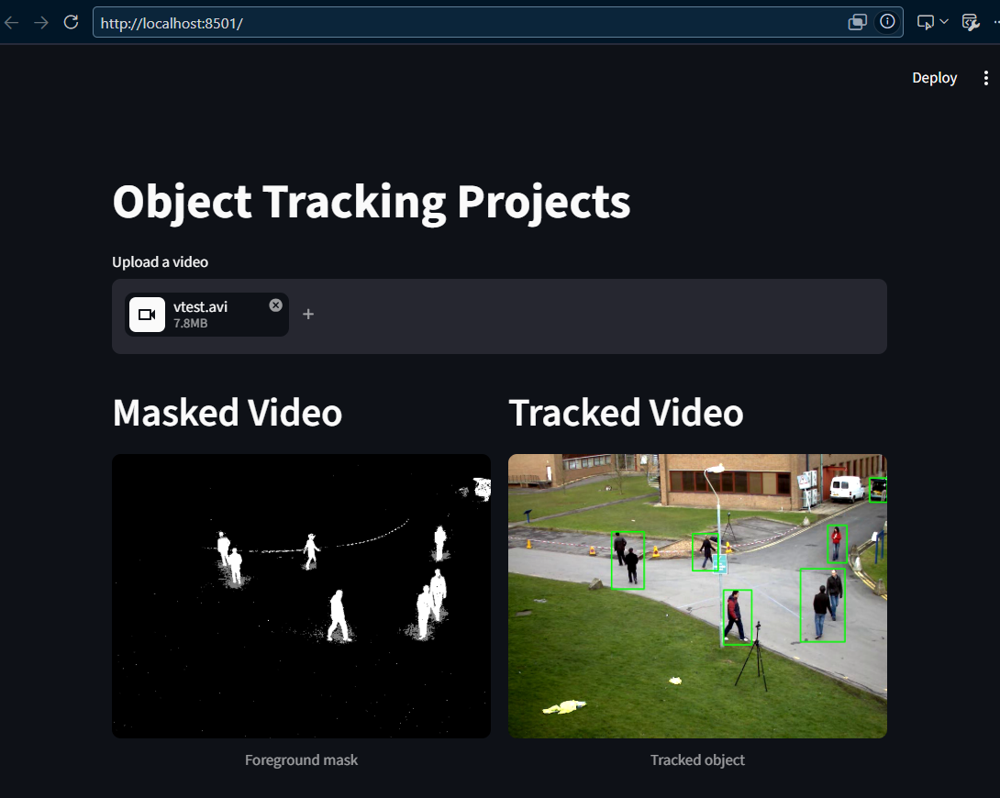

# Object Tracking App (Streamlit + OpenCV)



An interactive web application built with **Streamlit** and **OpenCV** that performs real-time foreground segmentation and moving-object bounding-box tracking on uploaded video files.

## Features

- **Video Upload:** Supports `.mp4`, `.avi`, and `.mov` video files via a Streamlit file uploader.
- **Background Subtraction:** Uses OpenCV's `BackgroundSubtractorMOG2` to model the background and extract foreground motion masks.
- **Contour Filtering & Bounding Boxes:** Detects external contours on the foreground mask, filters out small noise below a minimum contour area threshold (`500` px²), and draws green bounding boxes around detected moving regions.
- **Side-by-Side Live View:** Displays **Masked Video** (foreground mask) and **Tracked Video** (BGR-to-RGB converted frames with bounding boxes) side by side as frames are processed.

## Tech Stack

- **Python**
- **Streamlit** (UI and live frame rendering)
- **OpenCV (`cv2`)** (video capture, MOG2 background subtraction, contour detection, color conversion)
- **NumPy** & **Matplotlib** (imported in script)

## Project Setup & Installation

1. **Navigate to the project directory and activate your virtual environment:**
   ```powershell
   cd C:\Users\emsha\Documents\judy\AI-and-ML\ComputerVision\object-tracking-project
   .\.venv\Scripts\Activate.ps1